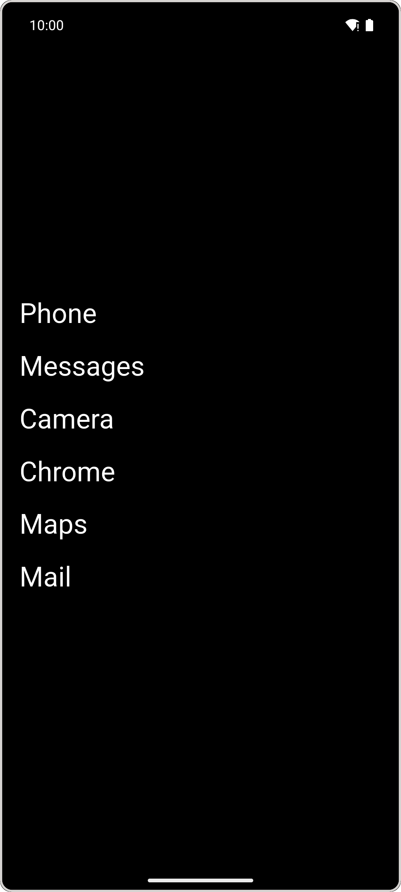
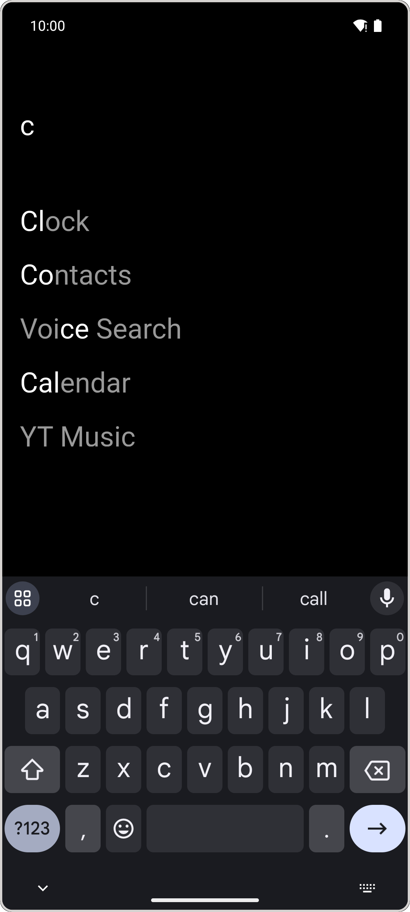
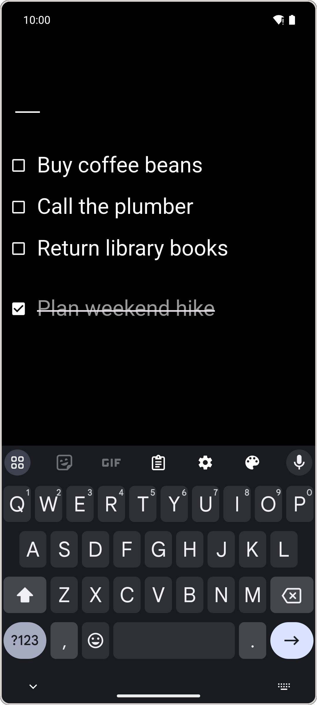
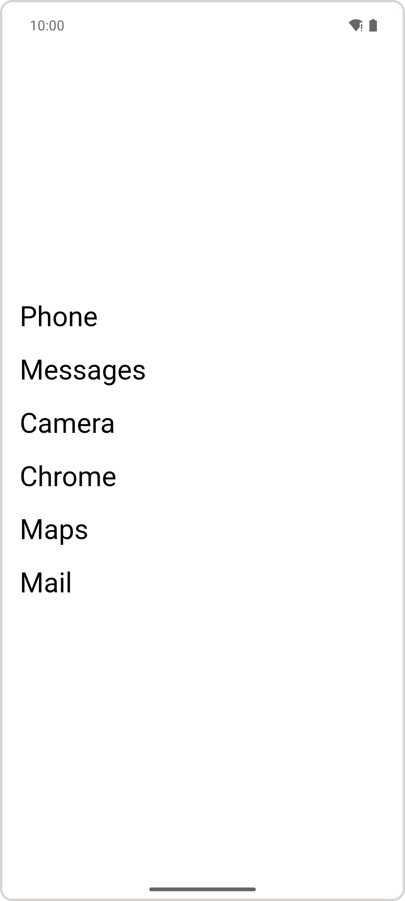
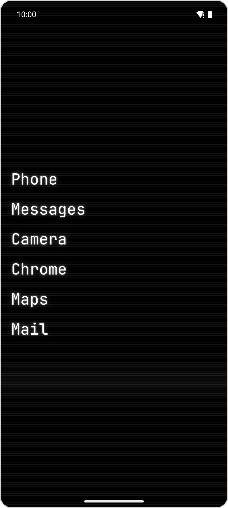
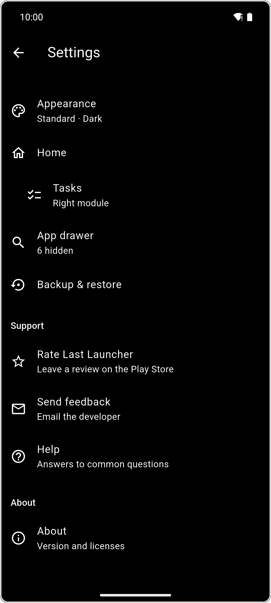

#  Last Launcher

**The last launcher you'll ever need.**

A home screen for Android with your apps as plain text. A few letters open any
app, a task list is a swipe away, and nothing else on the screen asks for your
attention. See [Getting started](#2-getting-started).

<br/>

[](https://github.com/jorritvanderheide/last-launcher/actions/workflows/ci.yml)
[](https://github.com/jorritvanderheide/last-launcher/releases)
[](https://f-droid.org/packages/nl.bw20.last_launcher/)

[](LICENSE)

<p align="center">
  
  
  
</p>

Your phone's home screen is built to be looked at. Icons in colours picked to
catch your eye, badges counting what you missed, widgets with news you didn't
ask for. You pick up your phone to send one message, and look up twenty
minutes later.

Last Launcher shows your apps as words on a quiet screen. Swipe up and type a
few letters: as soon as one app is left, it opens, and after a week your
fingers know the way by themselves. Pin the handful you use most to the home
screen, give them the names you think of them by, and keep a task list, or
one more app, a swipe to the side. It has no internet permission, so
everything you set up stays on your phone.

<br/>

## 1 Installation

[F-Droid](https://f-droid.org/packages/nl.bw20.last_launcher/) builds Last
Launcher from this source. It's also on
[Google Play](https://play.google.com/store/apps/details?id=nl.bw20.last_launcher),
and the APKs are on the
[releases](https://github.com/jorritvanderheide/last-launcher/releases) page:
`last-launcher-arm64-v8a.apk` fits almost every phone, `armeabi-v7a` is for
older 32-bit ones. It needs Android 7.0 or newer.

Each source signs the app with its own key, so one can't update another. To
switch, see the [FAQ](FAQ.md#can-i-switch-between-f-droid-google-play-and-the-apk-from-the-releases).

To build it yourself, see [Development](docs/development.md).

<br/>

## 2 Getting started

1. **Make it your home app.** Open Last Launcher and it offers to become one.
   Pressing home now brings you here.
2. **Find an app.** Swipe up and start typing. As soon as only one app
   matches, it opens.
3. **Pin your favourites.** In the app drawer, press and hold an app and choose
   **Pin**. On the home screen, press and hold it to **Rename** it, or hold and
   drag it to a new place.
4. **Add a module.** Press and hold an empty spot on the home screen for the
   settings. Under **Home**, set the **Left module** or **Right module** to
   **Tasks**, and swipe that way for your task list.
5. **Make it yours.** Under **Appearance**, pick light or dark, the text size
   and alignment, or the retro **Extra** style.

The hints on the home screen tell you where things are. Once you know, turn off
**Show hints** under **Appearance**.

<br/>

## 3 Safety and quality

Last Launcher has no internet permission and connects to nothing. Your
settings, pinned apps and tasks are kept on your phone, and only leave it in a
backup you export yourself. The accessibility service, the one permission
that could see more, does a single thing: lock the screen when you double tap,
and only if you turn it on. [Section 9](#9-permissions-and-data-disclosure)
lists exactly what it reads, stores and opens.

Every push is checked: formatting, static analysis with every lint turned on,
and over 250 tests of search, hints, gestures, settings and backups. Releases
are built in the open with a signed attestation, so you can check that the APK
you downloaded is the one that was built.
[Section 9.4](#94-how-releases-are-built) says how.

<br/>

## Table of contents

- [4 Documentation](#4-documentation)
- [5 Features](#5-features)
- [6 Search prefixes](#6-search-prefixes)
- [7 Gestures](#7-gestures)
- [8 Settings](#8-settings)
- [9 Permissions and data disclosure](#9-permissions-and-data-disclosure)
- [10 Questions or issues?](#10-questions-or-issues)
- [11 Support](#11-support)
- [12 License](#12-license)

<br/>

## 4 Documentation

If you want to work on Last Launcher, or know how it keeps your data:

- [**FAQ**](FAQ.md) - Answers to the most common questions, such as an app
  that's missing from the drawer or moving to a new phone.
- [**Compatibility**](docs/compatibility.md) - What a release may change:
  stored settings and backups. Changes are in [CHANGELOG.md](CHANGELOG.md).
- [**Architecture**](docs/architecture.md) - How the code is laid out, and
  where the state lives.
- [**Development**](docs/development.md) - Setup, tests, translations and
  releases.
- [**Privacy policy**](PRIVACY_POLICY.md) and [**security policy**](SECURITY.md).

<br/>

## 5 Features

### 5.1 Search

Swipe up for the app drawer. The keyboard is already open, so you just type.
Search ignores accents and spaces, ranks apps that start with what you typed
first, and opens an app once it's the only match.

- **Quick launch hints** mark the fewest letters that open each app, so you
  learn the shortest way.
- **Extra character** waits for one more letter before opening, if apps with
  similar names keep opening too early.
- **Search only** shows no list at all: just the field, until you type.
- **Match original name** finds an app you renamed by its own name too.

### 5.2 The home screen

Up to 10 pinned apps, as large or small as you like, under the names you give
them. Press and hold one to rename or unpin it, or hold it and drag it to a new
place. **Lock layout** keeps everything where it is. Pull down for quick
settings, and double tap to lock your phone.

### 5.3 Modules

The left and right of home can each hold a module:

- **Tasks:** a plain task list. Type to add a task, or to find one. Tap to
  rename it, tick it off, and hold it to drag it. Done tasks can be removed
  right away, or at the end of the day.
- **Launch app:** opens an app of your choice when you swipe that way, such as
  your camera or your notes.

### 5.4 Looks

<p align="center">
  
  
  
</p>

System, light or dark, with a pure black dark mode for OLED screens. Choose
the font, text size and alignment, and let **Accent color** tint it all in your
system's colours. The **Extra** style turns on a retro terminal: a monospace
font, scanlines, a glow and a blinking cursor, each of which you can also turn
on by itself.

### 5.5 Work profile

Work apps show up with your other apps, marked with a small dot, and can be
pinned. Start a search with `.` for work apps only, or with a space for
personal ones. While the work profile is paused its apps step aside, and
pinned ones keep their place.

### 5.6 Backups

**Backup & restore** saves your settings, labels, hidden and pinned apps to a
file, and your tasks if you want them too. Restore it on the same phone or on
a new one. Android's own backup doesn't include Last Launcher, so this is the
way to move.

### 5.7 Languages

English, Czech, Dutch, Finnish, French, German, Hindi, Japanese, Korean,
Polish, Portuguese, Spanish, Swedish and Traditional Chinese, following your
phone's language.

<br/>

## 6 Search prefixes

A search prefix turns the search field into a shortcut. Type the prefix, then
what you're looking for, and press enter:

- **Open a link:** a web search, a map, the Play Store. The link has `%s`
  where your search goes, such as `https://duckduckgo.com/?q=%s`. **Start
  from** offers DuckDuckGo, Google, Wikipedia, YouTube, Maps and the Play
  Store. Android opens the link in the app it always uses, or in the one you
  choose under **Open with**.
- **Search in an app:** hands your search to an app with a search of its own,
  such as a notes or music app.

With a work profile, two prefixes are there from the start: `.` for work apps
and a space for personal ones. Set them up under **App drawer → Search
prefixes**.

A prefix that starts like an app's name hides that app from search: with `g`
for Google, typing `g` for Gmail searches the web. End the prefix with a space
(`g `), or start it with a symbol (`!g`), and both work.

<br/>

## 7 Gestures

| Gesture | What it does |
| --- | --- |
| Swipe up on home | The app drawer |
| Swipe right or left on home | The left or right module |
| Pull down on home | Quick settings |
| Double tap on home | Locks the screen (**Double tap to sleep**) |
| Press and hold an empty spot on home | Settings |
| Press and hold an app | Its actions: **Rename**, **Pin** or **Unpin**, **Hide**, **App info** |
| Press and hold a row, then drag | Moves it, on home and in the task list |
| Enter in the search field | Opens the first result, or runs the prefix |
| Home button | Back to the home screen, from anywhere |

<br/>

## 8 Settings

Press and hold an empty spot on the home screen to open the settings.

| Page | Setting | What it does |
| --- | --- | --- |
| Appearance | **Theme** | System, Light or Dark. |
| | **Style** | Standard, Extra (the retro terminal look), or Custom once you change one of the options below. |
| | **Font**, **Text size**, **Text alignment** | How the app names look. |
| | **Accent color** | Tint text and background with your system accent. |
| | **Terminal prompt** | Show search as a command line. |
| | **Glow**, **Scanlines**, **Animations** | The retro effects, in dark mode only. |
| | **Fullscreen** | Hide the status bar and navigation. |
| | **Show hints** | Show usage hints throughout the app. |
| Home | **Lock layout** | Turn off pinning and long press on the home screen. |
| | **Double tap to sleep** | Lock the screen with a double tap. Needs the accessibility service. |
| | **Left module**, **Right module** | What a swipe to either side shows: none, Tasks or Launch app. |
| App drawer | **Drawer mode** | List, or Search only. |
| | **Hidden apps** | The apps you hid, to unhide or rename them. |
| | **Hide pinned apps** | Leave pinned apps out of the drawer. |
| | **Search prefixes** | See [section 6](#6-search-prefixes). |
| | **Include hidden in search** | Let search find hidden apps too. |
| | **Match original name** | Find renamed apps by their own name. |
| | **Show keyboard** | Open the keyboard when the drawer opens. |
| | **Auto-launch on match** | Open an app when it's the only match. |
| | **Extra character** | Wait for one more letter before opening it. |
| | **Quick launch hints** | Mark the fewest letters that open each app. |
| Tasks | **Show keyboard**, **Remove on complete**, **Clear completed daily** | How the task list behaves. |
| Launch app | **Left app**, **Right app** | Which app each side opens. |
| Work profile | **Don't show non-work apps**, **Show work app dot**, **Show work dot on home screen** | How work apps show. Only there with a work profile. |
| Backup & restore | **Export backup**, **Restore backup** | See [Backups](#56-backups). |

<br/>

## 9 Permissions and data disclosure

Last Launcher has no internet permission, no analytics, no crash reporting, no
ads and no Google Play Services.

### 9.1 Permissions

- **See all apps** (`QUERY_ALL_PACKAGES`): to list your apps, which is what a
  launcher is for.
- **Expand the status bar** (`EXPAND_STATUS_BAR`): to open quick settings when
  you pull down on home.
- **Accessibility service**, off until you turn it on: to lock the screen when
  you double tap. It can't read what's on the screen or what you type, and
  does nothing else.

### 9.2 What it stores

On your phone only, in the app's own storage: your settings, pinned apps,
custom names, hidden apps, search prefixes and tasks. Android's backup to the
cloud is turned off for it. A backup is written only when you export one, to a
file and a place you pick. Uninstalling removes everything.

### 9.3 What it opens

- **Your apps,** their App info page, and the system settings pages it sends
  you to: default apps, accessibility.
- **Links and app searches** from your search prefixes, in another app.
- **Shortcuts** that another app asks to add, such as a website you add to the
  home screen from your browser. They're kept by Android, and listed with your
  apps.
- **From the settings:** Help opens the [FAQ](FAQ.md), Send feedback your
  email app, and Rate or Donate the Play Store or Liberapay, each in your
  browser or the app that handles it.

### 9.4 How releases are built

Every push is checked by GitHub Actions: formatting, `flutter analyze` with
infos as errors, and the tests.

Releases are built by GitHub Actions from the tagged source, after the same
checks, with every action pinned to an exact version. The APKs and the App
Bundle are signed with the release key, listed with their checksums in
`SHA256SUMS`. Releases after 1.3.0 also come with a signed build provenance
attestation, so you can check that what you downloaded is what was built:

```sh
gh attestation verify last-launcher-arm64-v8a.apk --repo jorritvanderheide/last-launcher
```

F-Droid builds its copy from the same source on its own servers, and signs it
with its own key.

<br/>

## 10 Questions or issues?

Have a look at the [FAQ](FAQ.md) first: it covers the most common surprises,
like an app that's missing from the drawer or the accessibility service. If
something still doesn't work, or you have an idea, please
[open an issue](https://codeberg.org/BW20/last-launcher/issues/new/choose), or
use **Send feedback** in the settings. Found a security problem? Please report
it privately, as described in the [security policy](SECURITY.md).

The source and the issues live on
[Codeberg](https://codeberg.org/BW20/last-launcher). The source is mirrored to
[GitHub](https://github.com/jorritvanderheide/last-launcher), where the releases
are built.

<br/>

## 11 Support

Last Launcher is free. If you find it useful, you can support its development
on Liberapay:

[](https://liberapay.com/BW20)

<br/>

## 12 License

Copyright © 2026 Jorrit van der Heide. Licensed under the [EUPL-1.2](LICENSE).

Bundled: the JetBrains Mono typeface (SIL Open Font License 1.1).
