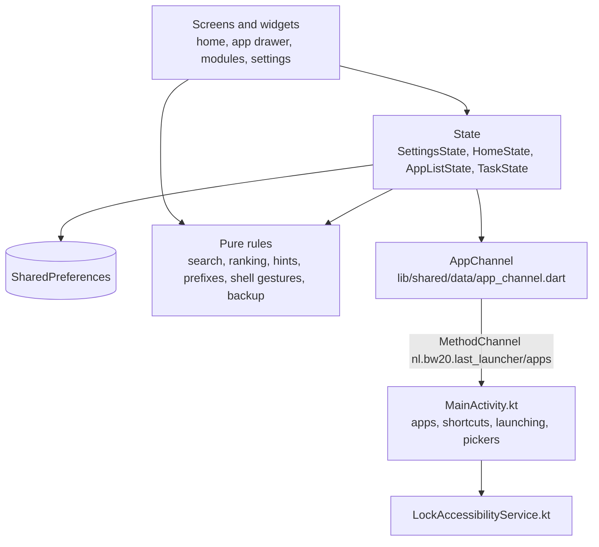

# Architecture

Last Launcher is a Flutter app for Android only. The Dart side draws
everything and holds every rule; a thin Kotlin side does what only Android
can: list and open apps, read pinned shortcuts, lock the screen, and open the
system's file pickers and settings.

## Where state lives

- **SharedPreferences is the record.** Settings, pinned apps, labels, hidden
  apps, search prefixes and tasks are all keys in it, read at start and
  written on every change. Nothing else is stored, and nothing leaves the
  phone. Android's own backup is off (`allowBackup="false"`); Backup &
  restore is the way to move it.
- **The app list is asked for, not stored.** It comes from Android on start
  and every time the launcher comes back to the front, and anything pinned,
  labelled or hidden for an app that's gone is dropped then.
- **Shortcuts stay with Android.** A shortcut another app asks to pin is
  accepted by `PinShortcutActivity` and kept by Android; the launcher lists
  them with the apps.

## Layers

- **`main.dart`** builds the four states and the channel, loads the apps once,
  and starts `LastLauncherApp`.
- **`app.dart`** builds the theme from the look options and the system accent,
  and refreshes apps and the accent whenever the launcher comes back to the
  front.
- **`features/home/screens/launcher_shell.dart`** is the one screen: home in
  the middle, a module on each side, and the app drawer as a sheet over it.
  It keeps the pointer state and animations; what a drag means, and where it
  settles, is decided in `shell_gestures.dart`.

### State

Each state is a `ChangeNotifier` that owns its keys:

- **`SettingsState`** (`features/settings/`): every setting, declared once
  with its key, type and default. Rules that tie settings together are getters
  (`autoLaunchActive`, `quickLaunchHintsAvailable`), never writes, so a choice
  comes back when the rule stops applying. `_migrate` rewrites values stored
  by older versions before anything reads them.
- **`HomeState`** (`features/home/`): the pinned apps, and how many fit.
- **`AppListState`** (`features/app_drawer/`): the installed apps, custom
  labels, hidden apps and the current search.
- **`TaskState`** (`features/modules/tasks/`): the task list.

After a restore, each one re-reads everything with `reload()`, so nobody has
to restart the launcher.

### Pure rules

The decisions are in plain Dart without widgets, and each has a test:

- **Search** (`app_drawer/search.dart`, `ranking.dart`): a query is split into
  a prefix and a search term, matched against names with accents folded away
  (`shared/data/fold_for_search.dart`), and ranked. `DrawerResults` is built
  once per query and shared by the list, auto-launch and the keyboard's enter
  key, so all three agree on which app a query means.
- **Quick launch hints** (`shared/data/hints.dart`): the shortest part of
  each name that no other name has.
- **Search prefixes** (`app_drawer/prefixes.dart`): filters for work or
  personal apps, links, and searches in an app. A prefix type that a newer
  version added is skipped, not an error.
- **Shell gestures** (`home/shell_gestures.dart`): what a drag becomes, where
  it follows the finger and where it settles.
- **Backup** (`settings/backup.dart`): the file format, see
  [Compatibility](compatibility.md).

### Modules

The left and right of home each hold a module: none, Tasks or Launch app. A
module implements `LauncherModule` (`features/modules/launcher_module.dart`)
and is added to `launcherModules`; the settings, the hints on home and backups
pick it up from there. A module's own data, such as the tasks, is listed in
`storageKeys`, so a backup can leave it out.

### The Kotlin side

`android/app/src/main/kotlin/nl/bw20/last_launcher/`:

- **`MainActivity.kt`** answers the method channel: the apps of every profile
  (skipping a paused work profile) and their pinned shortcuts, launching,
  App info, quick settings, fullscreen, the system accent, opening links and
  app searches for prefixes, the file pickers for backups, and whether this is
  the default launcher. It tells the Dart side when home is pressed
  (`goHome`) or when the system asks for the settings (`openSettings`).
- **`PinShortcutActivity.kt`** accepts "Add to home screen" requests.
- **`LockAccessibilityService.kt`** locks the screen, and does nothing else.
  Its configuration can't read window content.

## Looks

The look is a set of separate options in `SettingsState`; Standard and Extra
are presets of them, worked out from the options rather than stored.
`app_theme.dart` turns them into a `ThemeData` per brightness, and
`AppearanceScope` hands the rest (text size, alignment, effects) to the
widgets. Glow and scanlines only show in dark mode.

## Translations

The interface is in 14 languages: `lib/l10n/app_<code>.arb`, with English
(`app_en.arb`) as the template. `flutter gen-l10n` turns them into the
`app_localizations*.dart` files next to them, which are committed. The store
listings are in `fastlane/metadata/android/<locale>/`.
