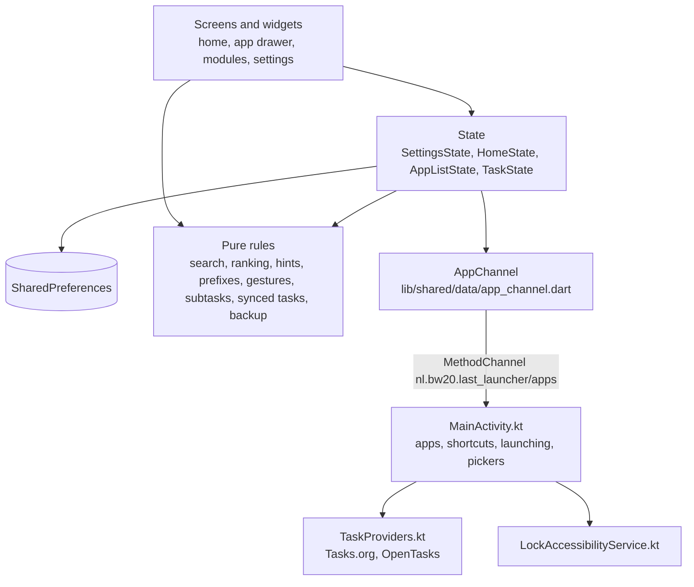

# Architecture

Last Launcher is a Flutter app for Android only. The Dart side draws
everything and holds every rule; a thin Kotlin side does what only Android
can: list and open apps, read pinned shortcuts, lock the screen, read and
write a tasks app's list, and open the system's file pickers and settings.

## Where state lives

- **SharedPreferences is the record.** Settings, pinned apps, labels, hidden
  apps, search prefixes and tasks are all keys in it (see
  [Data model](data-model.md)), read at start and written on every change.
  Nothing else is stored, and nothing leaves the phone. Android's own backup
  is off (`allowBackup="false"`); Backup & restore is the way to move it.
- **The app list is asked for, not stored.** It comes from Android on start
  and every time the launcher comes back to the front, and anything pinned,
  labelled or hidden for an app that's gone is dropped then.
- **Shortcuts stay with Android.** A shortcut another app asks to pin is
  accepted by `PinShortcutActivity`, once you say yes, and kept by Android;
  the launcher lists them with the apps.
- **A synced task list stays in its tasks app.** The launcher reads it from
  Tasks.org or OpenTasks, and keeps only its order and which done tasks it
  hides.

## Layers

Screens and widgets show state and pass on what you do. The states keep the
stored keys and call the pure rules, files that don't import Flutter
themselves. The Kotlin side is only reached through `AppChannel`.

| Path | What it holds |
| --- | --- |
| `lib/main.dart` | Builds the four states and the channel, loads the apps once, and starts the app |
| `lib/app.dart`, `lib/app_theme.dart` | The theme from the look options and the system accent; refreshing apps, the accent and a synced task list whenever the launcher comes back to the front |
| **`lib/features/home/`** | **Home, and the screen everything sits on** |
| `screens/launcher_shell.dart` | The one screen: home in the middle, a module on each side, the app drawer as a sheet over it. It keeps the pointer state and animations, and launches apps |
| `shell_gestures.dart` | What a drag becomes, where it follows the finger and where it settles |
| `home_state.dart`, `screens/home_screen.dart` | The pinned apps, how many fit, and the home screen |
| **`lib/features/app_drawer/`** | **Search** |
| `search.dart`, `ranking.dart` | Matching a query against names, and the order of the results (`DrawerResults`) |
| `prefixes.dart`, `prefix_names.dart` | Search prefixes and what they do |
| `app_list_state.dart` | The installed apps, custom labels, hidden apps and the current query |
| `widgets/app_drawer_sheet.dart` | The drawer: its list, auto-launch and Enter |
| **`lib/features/modules/`** | **The sides of home** |
| `launcher_module.dart`, `none_module.dart` | What a module is, and the list of them |
| `tasks_module.dart`, `tasks/` | The task list: `task.dart`, `subtasks.dart` and `synced_tasks.dart` (its rules), `task_state.dart`, `screens/task_screen.dart` |
| `launch_app_module.dart`, `launch_app/` | Launch app, and its settings page |
| **`lib/features/settings/`** | **Settings and backups** |
| `settings_state.dart` | Every setting, its key, type and default; the rules between them; `_migrate` |
| `backup.dart` | The backup file: writing, reading and restoring it |
| `screens/`, `widgets/settings_tiles.dart` | The settings pages, and the rows they're made of |
| **`lib/shared/`** | **What more than one feature uses** |
| `data/app_channel.dart` | The method channel to Kotlin |
| `data/models.dart` | Apps, pinned apps and app keys |
| `data/hints.dart`, `data/fold_for_search.dart` | Quick launch hints, and names with accents folded away |
| `search_focus_controller.dart` | When a search field opens and closes the keyboard |
| `widgets/` | Rows, the search field, the look (`appearance_scope.dart`) and the scanlines |
| `lib/l10n/` | The interface in English, Dutch and Simplified Chinese: `.arb` files and the Dart generated from them, which is committed |
| **`android/app/src/main/kotlin/nl/bw20/last_launcher/`** | **The Kotlin side** |
| `MainActivity.kt` | Answers the method channel: the apps of every profile (skipping a paused work profile) and their shortcuts, launching, App info, quick settings, fullscreen, the system accent, links and app searches for prefixes, the file pickers, the task permission, and whether this is the default launcher. Tells the Dart side when home is pressed (`goHome`), the system asks for the settings (`openSettings`) or the synced tasks changed (`tasksChanged`) |
| `PinShortcutActivity.kt` | Asks you about an "Add to home screen" request, and accepts it if you say yes. Its words are Android strings, in `res/values` and `res/values-nl` |
| `TaskProviders.kt` | Reads and writes one list in Tasks.org or OpenTasks, through their OpenTasks provider, and watches it for changes. `MainActivity` runs its calls off the main thread, since the tasks app may have to start first |
| `LockAccessibilityService.kt` | Locks the screen |
| `test/` | Tests, named after what they test |
| `fastlane/metadata/android/` | The store listings, in English and Dutch |
| `.github/workflows/` | CI, and the release build |

## A search, from keystroke to app

1. The search field hands each change to `AppListState.filter`, and the
   drawer builds `DrawerResults` once for the query: the prefix split off,
   the names matched with accents folded away, and ranked. The list,
   auto-launch and Enter all use that one result, so they agree on which app
   a query means.
2. If auto-launch is on and one app is left, it opens. It waits while the
   query could still become a search prefix (`g` on the way to `g `), and,
   with Extra character, for one more letter that keeps the same app.
3. Enter opens the first result, or runs the prefix's action.
4. `LauncherShell` asks `AppChannel.launchApp`, and closes the drawer.
5. `MainActivity` opens the app, through `LauncherApps` in the work profile
   for a work app, or the shortcut, for one.

## Rules

**Every decision is in pure Dart, with a test.** Search and ranking, quick
launch hints, search prefixes, what a drag on the shell becomes, subtasks,
synced task lists, backups and the rules between settings are plain Dart
without widgets. Screens and the Kotlin side only wire them up, so the rules
are tested without a phone.

**It connects to nothing.** The app has no INTERNET permission. A search
prefix that opens a link hands it to another app; a synced task list is read
and written through the tasks app on the phone, and DAVx⁵ syncs it.

**The accessibility service only locks the screen.** Its configuration can't
read window content, and it must never do more.

**Every setting is declared once.** In `SettingsState`, with its key, type
and default. A stored key never changes: a setting renamed, or changed in
meaning, needs a step in `_migrate` and a test that loads the old value (see
[Compatibility](compatibility.md)).

**Rules between settings are derived, never written.** Getters such as
`autoLaunchActive` and `quickLaunchHintsAvailable` work out what's in effect,
so what you picked comes back when the rule stops applying.

**A value from another version never crashes the launcher.** A key holding
the wrong type, an unknown choice or a search prefix of an unknown type reads
as unset, and gets its default or is skipped.

**After a restore, every state reads everything again** with `reload()`, so
nobody has to restart the launcher.

**A module brings its own data.** A module implements `LauncherModule` and is
added to `launcherModules`; the settings, the hints on home and backups pick
it up from there. Its own data, such as the tasks, is its `storageKeys`, so a
backup can leave it out.

**A synced task list is the phone's list, changed by the same rules.**
`TaskState` reads the rows from `TaskProviders.kt` into the same flat list
with `arrangeSynced`, and every change goes through the same rules as the
phone's list. `syncedChanges` turns the list before and after into inserts,
updates and deletes, which `TaskProviders.kt` makes in order. Tasks added
here then get the provider's ids, and a change sent before that answer came
is sent with them (`TaskChange.withIds`). The order isn't written, since
CalDAV has none that apps share. It reads the list again when the provider
says something changed, and when the launcher comes back to the front. A
read that ran while a change was made is thrown away and done again, so it
can't undo the change. A repeating task is never ticked off here: its own app
knows when it comes next, so the launcher opens that app instead.

**A synced list only takes changes once it's read and fine** (`canChange`),
so nothing you type is lost to a list that can't take it. When it can't (the
app gone, no permission, the list gone, or a change turned down),
`TaskSyncStatus` says why, and the task list shows it with a tap to put it
right.

**A look is a set of options; Standard and Extra are worked out from them,
not stored.** `app_theme.dart` turns the options into a `ThemeData` per
brightness, and `AppearanceScope` hands the rest (text size, alignment,
effects) to the widgets. Alignment is left everywhere but on home:
`LauncherShell` wraps `HomeScreen` in a scope with the Alignment setting's
own. Glow and scanlines only show in dark mode.
